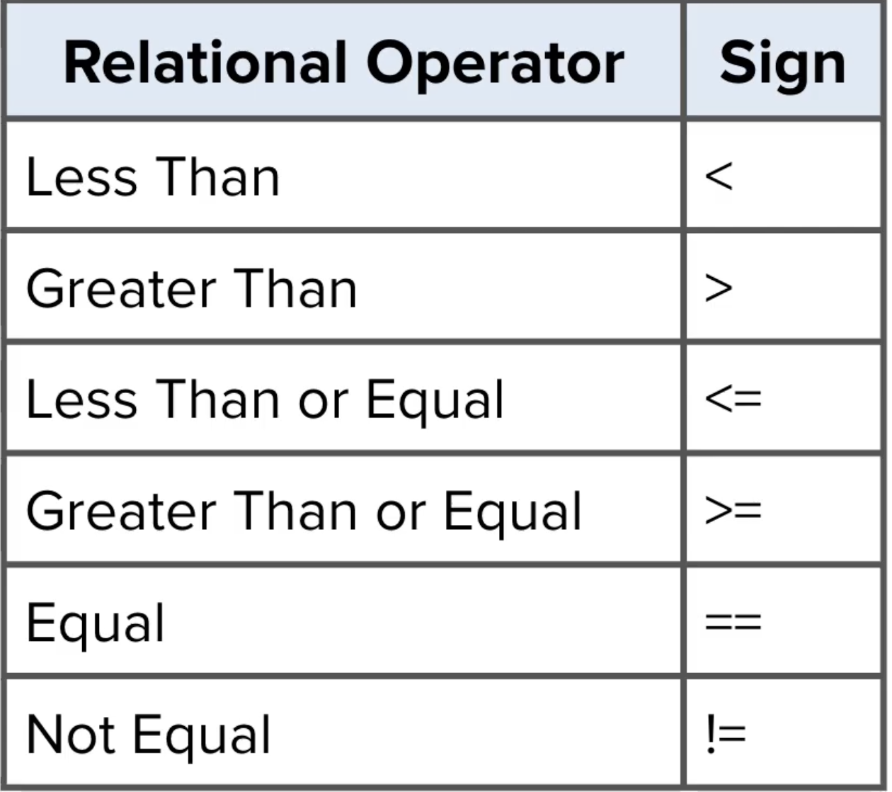

# Boolean Expressions

- A boolean expression is a statement that can be true or false.
- Relational Operators can create boolean expressions. Relational Operators:

- You can use these to compare the values of ints and doubles.
- When comparing two reference variables: Even if they are the same type and value with the same attributes, the comparison equal will result in false as they will be written in a seperate memory.
- So here you are comparing the memory addresses of the variables, not the objects themselves. 
